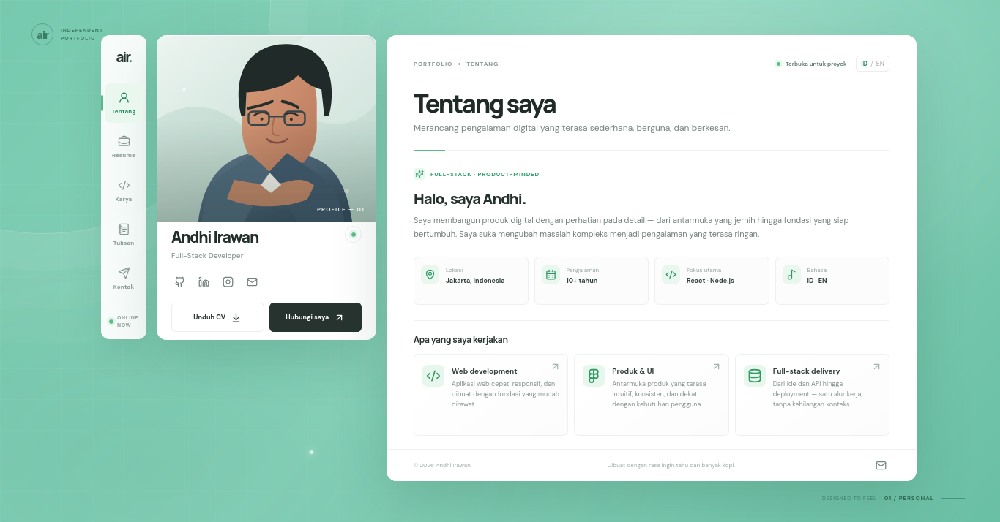

<h1 align="center">Andhi Irawan — Personal Portfolio</h1>

<p align="center">
  <code>Full-Stack Developer · Jakarta, Indonesia</code><br>
  Portofolio personal yang responsif, bilingual, dan dirancang dengan React.
</p>

<p align="center">
  
  
  
  
</p>

<p align="center">
  
</p>

---

## Tentang proyek

Website ini adalah portofolio personal **Andhi Irawan**, dibuat dengan React, TypeScript, dan Vite. Desainnya memadukan kartu profil, navigasi ringkas, dan panel konten bernuansa hijau mint untuk menampilkan profil profesional dengan rapi di desktop maupun ponsel.

## Fitur

- **Profil personal** dengan ilustrasi avatar, informasi singkat, tautan sosial, dan tombol unduh CV.
- **Lima bagian navigasi**: Tentang, Resume, Karya, Tulisan, dan Kontak.
- **Dua pilihan bahasa**, Indonesia dan English.
- **Resume profesional** berisi pengalaman, pendidikan/pengembangan diri, serta keahlian.
- **Kartu proyek dan artikel** untuk menampilkan karya dan tulisan pilihan.
- **Formulir kontak** yang menyiapkan email melalui aplikasi email pengunjung.
- **Tampilan responsif** dengan aksen hijau mint dan detail visual high-tech yang halus.

## Teknologi

| Bagian | Teknologi |
| --- | --- |
| UI | React 18 + TypeScript 5 |
| Build tool | Vite 6 |
| Ikon | Lucide React |
| Styling | CSS kustom |
| Aset lokal | SVG |

## Menjalankan di lokal

Pastikan **Node.js 18 atau lebih baru** sudah terpasang. Kemudian klon repository dan jalankan perintah berikut:

```bash
git clone https://github.com/andhiirawan/andhiirawan-react-portfolio.git
cd andhiirawan-react-portfolio
npm ci
npm run dev
```

Buka alamat yang ditampilkan di terminal. Pada konfigurasi proyek ini, alamat default-nya adalah `http://localhost:3000/`.

### Perintah lain

| Perintah | Fungsi |
| --- | --- |
| `npm run dev` | Menjalankan server pengembangan dengan hot reload |
| `npm run build` | Membuat hasil build produksi di folder `dist/` |
| `npm run preview` | Menjalankan pratinjau lokal dari hasil build produksi |

## Struktur proyek

```text
.
├── docs/
│   └── screenshot.png             # Preview situs untuk halaman repository
├── public/
│   ├── brand-mark.svg              # Favicon
│   ├── cv-andhi-irawan.txt         # File CV yang dapat diunduh
│   └── profile-portrait.svg        # Ilustrasi avatar lokal
├── src/
│   ├── App.tsx                     # Konten, navigasi, bahasa, dan interaksi
│   ├── main.tsx                    # Entry point React
│   └── styles.css                  # Gaya dan breakpoint responsif
├── index.html
├── package.json
└── vite.config.ts
```

## Menyesuaikan konten

Ubah nama, peran, lokasi, teks Indonesia/Inggris, pengalaman, daftar karya, artikel, alamat email, dan tautan sosial di `src/App.tsx`. Untuk mengganti avatar, ubah `public/profile-portrait.svg`. Ganti isi CV contoh di `public/cv-andhi-irawan.txt` dengan CV final agar tombol **Unduh CV** menampilkan informasi yang benar.

Konten pengalaman, proyek, lokasi, dan kontak yang ada saat ini merupakan contoh awal. Periksa dan sesuaikan sebelum digunakan sebagai portofolio publik. Formulir kontak memakai `mailto:` sehingga membuka aplikasi email pengunjung; pengiriman melalui backend belum disiapkan.

## Kontak

Untuk pertanyaan atau peluang kolaborasi, gunakan bagian **Kontak** di website atau hubungi melalui tautan sosial yang ditampilkan pada kartu profil.

---

<p align="center">
  Dibuat dengan <code>React</code>, <code>TypeScript</code>, dan perhatian pada detail oleh <b>Andhi Irawan</b>.
</p>
